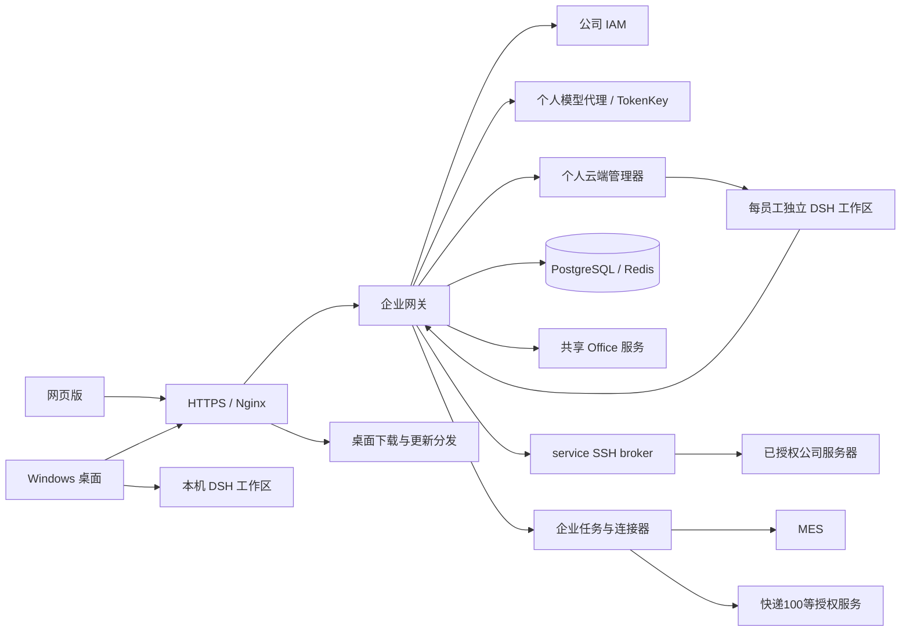

# 麦米 · MEGMEET AI

> **此分支正在实施 DSH 0.2.1-rc.2 全面升级（r65）。** [升级说明与构建入口](native-upgrade/README.md)列出原生功能、企业适配和实际测试边界。它是开发候选，公司仍运行下表中的 r62，正式桌面仍是 0.13.0。不能把本分支直接覆盖到生产目录。

面向企业员工的 AI 办公平台。麦米将原生 DSH 对话、本机与个人云端工作区、企业身份、个人模型授权和业务技能连接起来，提供网页版与 Windows 桌面入口。

**阅读导航：** [系统架构](docs/ARCHITECTURE.md) · [开发指南](docs/DEVELOPMENT.md) · [部署与运维](docs/DEPLOYMENT-OPERATIONS.md) · [配置管理](CONFIGURATION.md) · [第三方组件](THIRD-PARTY.md)

## 可以做什么

| 能力 | 使用方式 | 当前边界 |
| --- | --- | --- |
| 原生 AI 对话 | 网页或桌面进入工作区，使用本人获授权的模型 | 模型目录、调用权限与凭据由服务端核验 |
| 个人云端工作区 | 同一员工在网页、桌面访问自己的云端聊天与文件 | 云端按员工隔离；本机工作区数据不会因此自动同步上云 |
| 文档与表格处理 | 在对话中附加文件，调用 Office、PDF、OCR 等能力 | 格式、体积、转换器和模型能力各有边界，复杂版式仍需复核 |
| 物流查询 | 输入一条或多条销售发货单号 | MES 取物流记录，快递100取轨迹；预计时间有有效结果时展示 |
| 工卡制作 | 选择技能，导入名单并生成工卡文件 | 照片、模板和输入质量决定结果；企业加密上传已完成本次用户验收 |
| 其他企业任务 | 选择会议文档、图纸成本分析、基础设施监测等技能 | 各技能有独立配置、授权、任务状态与验收范围 |

“技能已显示”“服务健康”“任务执行结束”和“业务结果正确”是不同状态。新增企业能力需要同时验证身份、文件、执行、取消和结果展示，不能只检查菜单是否出现。

## 当前版本与仓库范围

更新日期：**2026-10-18**。本仓库保存麦米完整的自有应用源码、受控 DSH 覆盖、构建资料与开发文档，基于已发布的公司 GitLab 源码快照整理；本分支还包含未部署的 r65 原生升级候选。

| 层次 | 已确认状态 | 本仓库包含什么 |
| --- | --- | --- |
| 云端应用源 | r62 的公开增量已整合 | 网关、管理器、工作区覆盖、service broker 和公司 PPT 模板 |
| 公司云端运行版本 | r62 已部署，服务健康检查通过 | r62 的 service 输入区域仍未通过用户验收；另有新用户入口重连问题在排查 |
| 公司正式桌面 | 0.13.0 | 正式应用源码和构建适配；不表示已发布桌面提速候选 |
| DSH 原生运行时 | 0.2.0-rc.2 | 精确 npm 锁、受控覆盖与许可；完整安装树由依赖制品提供 |
| 企业加密上传 | r56 已部署并有用户验收 | 普通聊天及技能使用安全网关兼容上传协议；不执行服务端破解 |
| PPT 转换与进程回收 | r61 已部署，用户反馈转换恢复 | 工作区 init/512，Office init/256；公司模板和专用 Python 使用指引已收录 |
| service 入口修复 r63 | 本地候选封装与独立审查完成 | [验证摘要](experimental/service-entry-r63/README.md)；公司维护与用户验收待完成，仍属实验版本 |
| 任务沙箱 r64 | 容量与固定 SDK 契约已有合成测试 | [启用阻断项](experimental/sandbox-r64/runtime-provider/ACTIVATION-BLOCKERS.md)；未接管 DSH 执行、未部署 runsc，默认关闭 |

物流轨迹、预计送达、新快递100账号及本次企业加密文件读取已有用户验收；这不代替任意文件类型或全部业务结果的验收。较早文档中的 DSH 版本、并发人数、闲置时长和部署路径只作历史参考。版本口径见 [当前架构与版本](CURRENT-ARCHITECTURE.md)。

## 架构概览



网关持有企业身份与服务端凭据，管理器负责受控工作区生命周期，DSH 保留原生对话和工具协议。企业任务通过平台接口取授权文件、提交任务和返回结果，不接受模型任意指定员工身份、宿主路径或访问目标。详见 [架构与信任边界](docs/ARCHITECTURE.md)。

## 技术栈

以下是代码与依赖清单中的技术选择，不把开发锁当成生产机器完整软件清单。

| 部分 | 技术与锁定依据 |
| --- | --- |
| 网关 | Python、FastAPI、Uvicorn、HTTPX、psycopg、Redis 客户端；直接版本见 `services/gateway/requirements.txt`，本地测试完整锁见 `ops/local-env/requirements-test.lock.txt` |
| 原生工作区 | DSH **0.2.0-rc.2**；Linux 与 Windows 分别见 `runtime-build/package-lock-linux-x64.json`、`desktop-build/runtime-package-lock.json` |
| 网页界面 | DSH 原生前端、React 及受控品牌/工作区扩展；随同版运行时整体校验 |
| Windows 客户端 | Electron、Node.js、原生 DSH；依赖声明与运行时校验见 `desktop-local/package.json`、`desktop-local/dsh-adapter.cjs` |
| 办公引擎 | Python 文档库、LibreOffice、离线 OCR；Linux 精确依赖见 `office-engine/requirements-linux.lock.txt` |
| 数据与运行环境 | PostgreSQL、Redis、Docker、Compose、Nginx；实际镜像身份以发布清单和现场回执核对 |
| 企业接入 | IAM、个人 TokenKey、MES、快递100 HTTPS MCP；按连接器配置与授权启用 |

本仓库不是第三方 DSH 的完整上游源码镜像。上游依赖通过锁文件、integrity、许可及受控覆盖追溯，升级需要验证完整版本组。

## 从哪里开始

### 仅阅读或接手维护

1. 阅读 [架构](docs/ARCHITECTURE.md)，区分网关、管理器、员工工作区和业务任务。
2. 阅读 [开发指南](docs/DEVELOPMENT.md)，在隔离环境运行合成测试。
3. 涉及服务器变更时，先阅读 [部署与运维](docs/DEPLOYMENT-OPERATIONS.md)，核对正在运行的发布与私有配置。

### 最小本地验证

以下命令在仓库根目录、独立开发环境执行。它们验证合成接口与调度逻辑，**不会启动完整麦米，也不需要公司账号、物流 Key 或真实业务附件**。

```bash
python3 -m venv .venv
. .venv/bin/activate
python -m pip install -r services/gateway/requirements.txt -r ops/local-env/requirements-dev.txt
python -m pytest verification/logistics/tests/test_logistics_query.py verification/logistics/tests/test_logistics_mcp_integration.py -q
node --test services/personal-cloud/test-catalog.mjs services/personal-cloud/test-idle-control.mjs
```

文档准备时，后两条命令在已有本地依赖环境分别通过 40 项和 21 项测试；没有据此宣称全新机器安装、完整测试集或公司接口均已通过。安装依赖需要可用的软件源或受控离线缓存。Windows 激活方式与完整界面所需制品见 [开发指南](docs/DEVELOPMENT.md)。

完整环境需要额外的 DSH/Office 运行时制品、镜像与受控配置。仓库根 Compose 和历史构建脚本不是已验证的“一键生产安装器”。

## 目录说明

```text
.
├── services/
│   ├── gateway/              # 身份、模型、云端入口、文件与企业任务接口
│   │   └── maimi_projects/   # 工卡、会议文档、成本等任务实现
│   ├── personal-cloud/       # 管理器与工作区适配
│   └── office-service/       # 共享办公服务边界
├── desktop-local/            # 正式桌面应用源
├── desktop-build/            # 桌面运行时与构建适配资料
├── runtime-overlays/         # 已核对的 Linux 工作区覆盖与依赖锁
├── runtime-build/            # 运行时组装、校验与历史构建工具
├── office-engine/            # 文档、表格、PDF、OCR 引擎与依赖资料
├── db/migrations/            # 数据库结构迁移，无业务数据
├── toolkit/                  # 工具协议与适配
├── ops/                      # 配置、维护、分发和发布源码
├── verification/             # 独立验证用例与对应被测源码
├── release-sources/          # 历史发布公开源码与原始清单
├── dev-local/                # 合成本地开发环境及历史实验
├── docs/                     # 架构、开发、部署与专题文档
├── third_party/              # 第三方许可材料
└── archive/                  # 明确未发布或历史候选
```

`SOURCE-PROVENANCE.json` 说明本次快照的来源、版本和分发边界；逐文件来源与哈希由发布时单独冻结的清单核对。历史 `release-sources` 与根目录 Compose 保留原用途，**不因本次整合自动成为 r62 安装包**。当前组件挂载关系、外部制品以及剩余集成工作见 [r62 组件映射](docs/CURRENT-SOURCE-MAP.md)。

这次只是源代码备份与协作入口，不启动公司服务，不更改公司 GitLab，不启用自动部署。仓库内原有按发布版本固定的授权常量保留；物流说明中的示例脱敏及对应派生哈希同步见组件映射；没有导出账户数据库、当前登录凭据或员工附件。重新部署需要管理员配置并重新构建/校验，不能直接执行历史维护脚本。

## 代码管理、测试与发布

代码由公司 GitLab 和此 GitHub 源码快照协作维护，源码提交与生产发布分开管理。当前**没有已配置并验收的公司 CI/CD 或自动部署流水线**；首次整合提交请求跳过 CI，没有重启应用。

现行交付方式是：准备独立候选、运行相关测试、校验制品和发布基线，再由管理员经既有堡垒机在维护窗口执行对应版本工具，回传结果并做员工验收。部分步骤已脚本化，这不等于已实现无人值守持续部署。

变更建议使用独立分支和合并请求，说明具体行为、验证结果、影响范围与恢复办法。不要绕过历史工具的基线或哈希检查。建立 GitLab Runner、制品库和环境晋级门禁列为后续建设，见 [部署与运维路线](docs/DEPLOYMENT-OPERATIONS.md#推广前的建设清单)。

## 数据与安全约定

- 不提交真实密钥、令牌、私钥、私有电话规则、员工名单、照片、聊天、数据库备份或原始日志。
- 登录保持、云端计算资源保留、业务数据保留是三个独立机制。关闭页面后计算环境保留两小时，不代表数据永久保存或无限资源可用。
- 文件、模型和企业接口均在服务端做身份及作用域校验。浏览器显示某按钮不等于拥有操作授权。
- 企业透明加密应由公司安全网关处理；平台不会通过改后缀、base64 回放或服务端破解来绕过策略。
- 备份必须覆盖数据库、原生状态、工作文件及必要配置，且在隔离环境验证恢复。

仓库为公司内部项目，未声明整仓采用某个开源许可证。第三方组件分别遵循其许可，详见 [THIRD-PARTY.md](THIRD-PARTY.md)。
