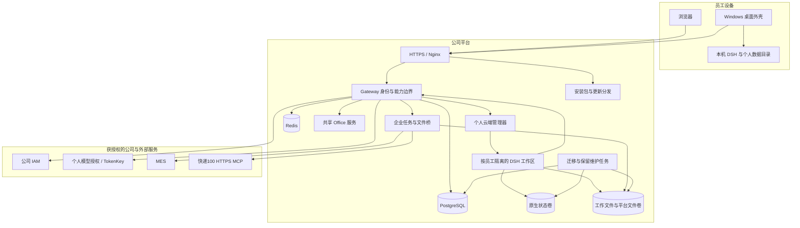
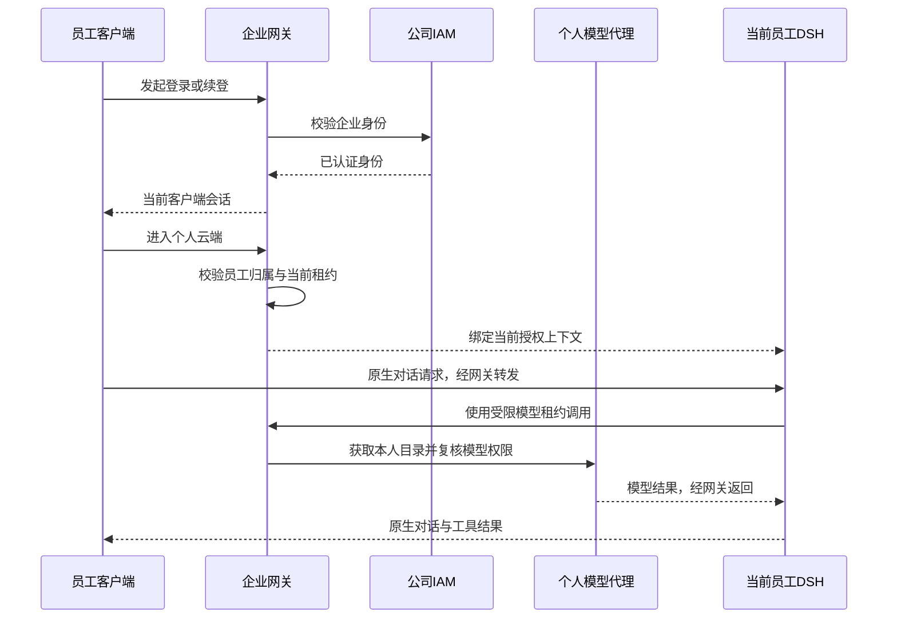

# 系统架构

> **2026-10-17 状态更新：** 本仓库已整合 r54/r56/r59/r61/r62 公开应用增量。较早版本叙述用于解释历史，当前状态以 [当前架构与版本](../CURRENT-ARCHITECTURE.md) 和 [组件源码映射](CURRENT-SOURCE-MAP.md) 为准。r63/r64 仅在 experimental，不是已部署能力。根 Compose 不能直接复原当前线上 r62。

本文说明当前麦米的职责划分、主要请求路径与数据边界。版本状态以 [CURRENT-ARCHITECTURE.md](../CURRENT-ARCHITECTURE.md) 为准：公司网关已运行 r56，管理器保留 r54；本仓库整合源码基础仍主要是 r52/r53，尚未收录这些后续增量。

## 系统组成

| 组件 | 职责 | 关键代码位置 |
| --- | --- | --- |
| 网关 | IAM、桌面授权、个人模型代理、云端入口、文件与能力授权 | `services/gateway/app` |
| 管理器 | 受控工作区创建、续接、资源准入、停机和维护协调 | `services/personal-cloud/manager.py` |
| 员工工作区 | 原生对话、会话、工具运行与当前员工的文件 | `services/personal-cloud`、`runtime-overlays/worker` |
| 企业任务 | 会话选择、短期执行许可、任务与输出文件 | `app/project_platform.py`、`maimi_projects` |
| 连接器 | 供应商协议、凭据边界、受限工具调用 | `app/enterprise_connectors.py`、`app/logistics_query.py` 等 |
| 共享办公服务 | 按授权作业接收文件、文档转换、PDF 与 OCR | `services/office-service`、`office-engine` |
| 数据服务 | 平台关系状态、会话与租约、业务元数据及对象引用 | `db/migrations`、网关存储模块 |
| 下载分发 | 桌面安装器、更新清单和静态下载 | `ops/desktop-distribution`、`ops/windows-installer` |

迁移任务负责数据库结构演进，保留维护任务负责按策略整理或清理数据。它们与网关同属平台，但不是每次请求都运行。已结束的一次性迁移容器不等于服务故障。

## 原生 DSH 与麦米扩展

DSH 提供原生前端、会话、工具、工作区及原生 RPC。麦米围绕它增加企业身份、个人模型策略、云端生命周期和业务接口。主要扩展集中在品牌入口、工作区、模型和工具桥，受版本与源码摘要约束。

Linux 与 Windows 运行时都固定为受验证的同版组件组。npm 锁、原始源码摘要、覆盖清单和版本校验器共同定义可交付组合。不能只改一个版本字符串、复制新 `node_modules` 或关闭校验，就认为完成 DSH 升级。

`runtime-overlays` 中的少量 `node_modules/.../lib` 文件是已发布的受控覆盖；它不是完整第三方依赖树。第三方同版完整原始源码未在本次整合中核实，依赖追溯以锁文件和许可资料为准。

## 身份与模型请求

客户端不会因为传入员工编号、工作区标识或模型名就取得权限。IAM 证明、客户端会话、工作区归属和服务端模型策略共同决定请求是否允许。

真实个人模型凭据由服务端保管。云端工作区使用受限租约访问代理，每次调用仍需核验；不能把长期 IAM 或 TokenKey 凭据注入模型提示词。目录显示的模型和真正可调用的模型也必须一致，前端选项不是授权来源。

## 登录与加载阶段

持续登录只减少重复授权，不等于计算环境永不停止。

| 阶段 | 执行内容 | 何时仍需等待 |
| --- | --- | --- |
| 身份恢复 | 恢复或刷新客户端会话，校验撤销状态 | 会话过期、公司接口变慢或需要重新授权 |
| 工作区续接 | 查找当前员工已有云端 Host | Host 已存在时优先热续接 |
| 冷启动 | 资源准入、准备目录和受控运行时、启动并检查原生服务 | 已释放工作区、维护后首次进入或资源紧张时 |
| 原生界面启动 | 载入前端模块、连接原生 RPC、同步工作区和会话 | 首次加载、版本变化或浏览器缓存不可用时 |
| 技能准备 | 读取原生技能与企业连接器目录、当前会话选择 | 接口响应、授权和当前配置会影响可用项 |

当前云端关闭全部客户端后保留计算环境 7200 秒，期间再次进入可以续接。r54 已将启动等待与共享调度锁分离，并限制并发启动；这减少相互阻塞，不代表硬件资源无限。

正式桌面完全退出会停止本机 DSH。正式版本默认先准备本机环境，再由用户进入云端；0.17.0 候选的本地提速不等于已经实现“桌面直接云端首启”。

## 文件与企业任务

原生会话附件、工作区文件、平台项目文件、任务成品分别有对象引用和授权规则。企业任务只获得当前员工、当前会话及当前执行许可允许的文件，不使用模型拼接的任意宿主路径。

当前项目协议包含会话选择、执行许可、作业状态、取消、结果和文件桥。作业状态中的 `completed` 表示执行链结束，结果仍可能是需要用户补充信息，不能直接解释为业务成功。

r56 已将普通文件上传改为标准单文件 multipart，并保留安全网关需要的 URL 文件元数据；认证后的网关再转换为原生字节上传。企业安全网关解密后长度可以变化，原生收据使用实际收到内容的长度和摘要。精确企业加密标记仍存在时会明确报错，不自动改编码重试。该改动由用户在普通聊天与技能中验收，但不代表所有格式都具有无限处理能力。

物流查询使用只读 MES 记录获得运单与必要上下文，再调用快递100。需要电话校验时，按服务端工厂规则选择来源，仅发送所需后四位。预计送达有有效数据时展示；缺失时不伪造时间或显示无意义占位。

## 数据与持久化

| 数据 | 主要位置与边界 |
| --- | --- |
| 本机聊天和文件 | 员工电脑独立数据目录；不随安装目录升级而删除，不自动上云 |
| 云端原生状态与历史 | 员工独立状态卷，原生格式是运行事实来源 |
| 云端工作文件 | 员工独立文件卷；工作区停止不等于文件立即删除 |
| 平台任务、授权、文件引用 | PostgreSQL；必要的敏感元数据按应用加密边界保存 |
| 平台文件与成品 | 对象文件卷与数据库引用配合；需要同时备份 |
| 会话、缓存及短期协调状态 | Redis 和相应服务端会话存储，不替代持久文件备份 |

计算资源回收和数据清理分开管理。当前代码包含可选的“整工作区连续不活跃 30 天”清理策略、数据库删除栅栏和显式会话删除；现场是否启用以配置和发布回执为准。旧文档中的“90+30 天回收”属于历史，不应据此承诺当前恢复窗口。

## 信任边界

- 公共 HTTPS 入口连接网关；原生端口、管理器、数据库和 Docker socket不直接暴露给员工。
- 只有管理器需要 Docker 管理能力，它属于高权限运维边界；网关不持有 Docker socket。
- 员工工作区使用固定镜像、受控挂载和资源限制。容器隔离不是对任意恶意代码的无限安全承诺。
- 登录撤销、会话删除、任务取消与长连接需要共同校验。取消必须区分“已确认停止”和“停止结果未知”。
- Office 引擎只处理获授权的文件与约定操作；转换器、OCR 和模型权限是不同层次。
- Milvus、Elasticsearch 等在历史本地环境有独立资料，当前普通聊天和核心部署不应被描述为必需或已全面接入的检索后端。

## 推广时的演进方向

后续应将多轮历史覆盖整理为可复现镜像构建，建立测试环境与制品晋级、监控和容量压测、备份恢复演练及依赖/许可管理。CI/CD、统一观测和自动运维都需要单独落地及验收，不能由“已有脚本”推定已经完成。
