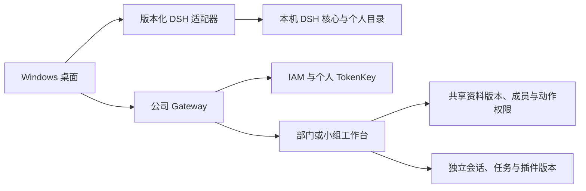

# MEGMEET 工作区平台与 DSH 升级边界

本轮目标：在保留原生 DSH 本地工作区、当前品牌和手选目录的前提下，提供本地、团队云端与明确授权的协同任务。公司部署/真实 IAM 未在本轮执行；实际验收结果见接续记录。

## 模块边界

桌面渲染进程不持 IAM token、真实个人 Key 或服务器服务密钥。Gateway 按每轮可信员工身份调用模型；共享空间不共用管理员 Key，也不共用可写 DSH_HOME。

DSH 升级涉及的 CLI 参数、模型 profile、启动握手与发行校验集中在适配器中。MEGMEET 原生扩展单独维护；品牌/声明等上游补丁有固定版本和原始内容摘要守卫，遇到不兼容上游停止构建，不能靠静默匹配新代码上线。

## 三种数据流

| 使用方式 | 输入范围 | 持久化与执行 |
| --- | --- | --- |
| 个人本地 | 员工在原生界面选择的文件夹、个人聊天 | 本机原生 DSH 历史与文件；模型请求经身份代理但不转云历史 |
| 团队云端 | 获准的部门/小组资料、本人云会话 | 服务器保存独立会话/任务；私有默认，明确共享后授权成员可读 |
| 本地与云协同 | 本轮明确选择的本地附件 + 指定云文档版本 | 只上传所选资料；服务端任务结果可明确导出到本地，旧个人历史不自动加入 |

个人调用部门知识时，检索范围以服务端成员和读取权限为准。把云资料放进个人持久历史或另存本机是一项明确动作；撤销云权限不会自动收回已合法导出的副本。检索文档是参考资料，不是可信系统指令。

## 团队数据与权限

- 部门空间同时核验 IAM 组织关系和显式成员授权；跨部门小组使用显式小组成员。工号为稳定主体，显示名称不作为权限键。
- 创建/发布资料、读取资料、普通云聊天、共享聊天、运行指定插件分别校验。桌面隐藏按钮不能代替后端鉴权。
- 云文档按不可变版本记录。更新必须携带看到的版本，过期编辑返回冲突，不能覆盖其他成员修改。
- 任务记录固定插件版本和文档版本；跨空间引用、无权文档、伪造身份、重复请求冲突均拒绝。返回结果/历史时复核当前访问范围。
- 团队知识不等于所有团队聊天。聊天私有默认；撤回共享不修改个人原生会话归属。

## 插件与执行

企业插件是服务端登记的业务能力，使用固定 runner、版本、模型策略和权限。客户端只提交选择与输入，不能上传任意 Python/JS/Shell 作为可执行插件。知识问答 runner 经过个人模型代理，合成文件统计 runner 仅供验证并显示模拟标记。

当前文本资料用于可验收的共享知识与混合任务链路。全文检索先使用数据库授权过滤后的检索；已安装 ES/Milvus 不代表已接入语义向量检索。完整远端 DSH 任意工具运行、Office/PDF 提取、大文件对象存储、分布式后台队列和企业业务插件需按实际类型继续适配，不用一个共用 Host 冒充多人隔离运行器。

## 升级与发布

1. 上游依赖在独立候选构建中固定版本；核对前端、核心、插件集合、Node、MEGMEET 扩展和数据格式兼容范围。
2. 执行兼容检查与本地回归：认证、原生手选目录、多轮/历史、工作台权限、文件版本、任务幂等与插件选择。
3. 发布桌面和服务器的已验证组合；公司模式校验云 API 版本。服务器先具备对应 API，再分发桌面。
4. 签名更新清单只接受公司固定公钥和批准来源。测试候选检查不等于具备生产签名；没有可信签名参数时不能自动安装。
5. 应用目录、个人数据目录、团队持久卷分开。升级不得删除员工目录、重置数据库或悄悄改写历史格式。

真实 IAM 注册、测试 IAM 与 TokenKey 配合、长沙网络/HTTPS、签名证书与发布权限仍是部署条件。千人注册数与并发运行数分别评估；本机功能验证不作容量承诺。
