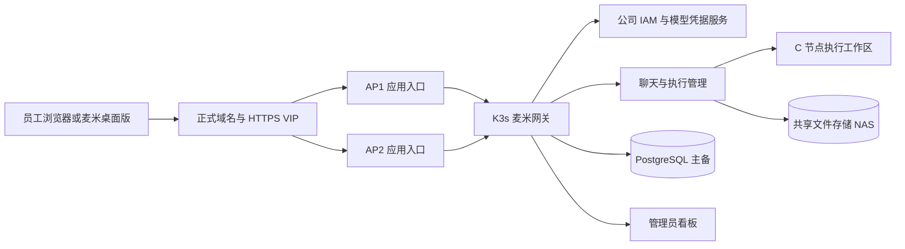

# 系统架构

正式环境有五台服务器。A1、A2 运行两份应用入口与网关。A1、A2、C 组成三个 K3s 节点，C 承载执行工作区。B1、B2 提供数据库主备。主库身份由协调服务判定，应用不能写死某一台为永久主库。

员工通过正式域名访问可在两个 AP 间漂移的 VIP。Web 入口对外使用 HTTPS 443。页面健康检查、集群健康与真实登录聊天分别验证。单节点测试环境使用独立域名、单机存储和测试 IAM。

部署时分别为 Pod 和 Service 选择虚拟网络地址池，按节点分配 Pod 子网。监控组件使用现场 Service 网段核对 Kubernetes API 地址。部署后应核对节点互访、数据库与 NAS 通路。

数据库负责结构化记录，包括身份关联、历史会话和文件索引。NAS 提供正式环境的共享文件空间。普通聊天和需要工具执行的任务分别排队，用户专属工作区按生命周期回收。应用层、数据库、对外入口及备份有各自的故障边界。
