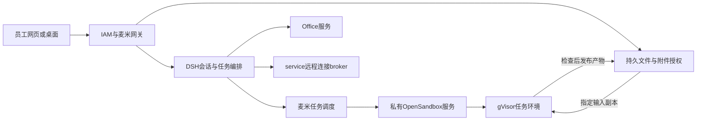

# 麦米任务沙箱实施方案（r64 本地开发稿）

状态：已获用户授权开展本地实现；公司环境未部署。现网仍为 r62。当前只有麦米一台公司服务器，不能把开发稿当作独立执行节点已具备。

## 已确认的起点

当前规划面向只有一台现有应用服务器的环境。新池必须与平台、员工工作区和 Office 共享资源，容量准入须从受控配置与上线前采样中取得，不能把某一时刻空闲内存视作长期可承诺预算。现有工作区配置上限为 1 CPU、1.5 GiB、512 个进程/线程槽位；Office 独立配置为 8 GiB、256 个槽位，均启用 init 回收。

历史对话、附件、生成文件属于持久数据；它们不直接占用进程名额。容器仍在运行时的服务进程、线程与尚未回收的子进程才占用这些名额。此次已解决的僵尸进程问题不能仅靠扩大额度处理。

## 最终采用的分层

1. **身份、会话、持久数据层**：沿用 IAM、网关、个人工作区、附件注册和会话归属。员工不选择物理执行服务器，也不能提交其他员工的身份标识。
2. **任务调度层**：增加麦米私有 broker，负责三元归属（员工、工作区、会话）、任务幂等、公平排队、资源承诺、取消、超时和产物归档。模型只能提出任务操作，不能指定 Docker 参数、镜像、宿主路径或凭据。
3. **隔离执行层**：采用固定 OpenSandbox 1.1.1 契约，并强制 gVisor/runsc。目前先在同一宿主的独立网络和资源域试点；缺少 runsc 或隔离检查不通过时拒绝执行，不自动降级成普通容器。
4. **专用能力层**：Office 转换继续走独立服务；service 远程连接继续走独立 SSH broker。目标服务器密码不会写入任务沙箱或交给模型。

## 一次任务的生命周期

用户请求经现有身份与会话验证后生成任务。调度器按员工公平排队，扣除资源预算后创建隔离环境。同一个任务的多个命令复用该环境；跨用户或新任务不复用旧的可写环境。上传文件只通过授权附件标识复制指定输入，原件不挂载到任务环境。生成文件在受控输出目录中，检查文件类型、大小与归属后发布到原会话。

执行结果不确定时，保留资源承诺并等待核对或销毁，不自动重复命令。取消、超时和空闲回收以整个任务环境为单位，不依赖模型自行清理进程。启动或销毁的响应丢失也不能立即把额度算作空闲。

## 同机部署的容量约束

新执行池与已有员工工作区、Office、数据库和网关共享宿主资源。可用内存采样不能直接当作可承诺给新沙箱的额度；要扣除既有工作区尚未使用的内存承诺和平台保留量。

试点不会在现有工作区额度之外再无条件增加一个大池。先接统一宿主准入与压力检查，只给指定试点员工开放有限并发；额度须结合 CPU、峰值、现有 Office 并发和实际任务压测确定。迁移文件/代码执行出个人工作区之后，再调整原工作区资源分配，避免长期双份保留。超过预算进入有界队列，页面明确显示排队、超时或拒绝原因。

## DSH 接入要求

必须让 shell、文件读写、子进程/终端、取消和产物读取使用同一个任务环境。单独新增一个沙箱工具，同时保留原本地执行路径，不能算完成迁移。先以显式试点配置接入，不改变全员默认 profile；本地 fallback 必须关闭。工具获得的范围来自可信任务上下文，模型请求中的 owner、session、URL 或路径不能替代服务器校验。

已核对本地 DSH rc.2 源码：`packages/sandbox/sandbox/README.md` 明确容器/远端执行应替换整个 `ctx.shell`、`ctx.fs` 与子进程能力；`packages/bundle/base/cordis.patch.yml` 默认装载本地 subprocess、bash-sandbox、fs-sandbox 与 Node PTC。`packages/ptc-runtime/ptc-runtime-node/src/launch.ts` 还要求在同一执行环境中有可映射的 bootstrap 和控制通道。因此 SDK 的一次命令调用只是底层能力，不能直接冒充完整 DSH 子进程协议；PTY、流式标准输入/输出、PTC 子调用控制通道及 bootstrap 路径都要单独接入验证。

## 隔离边界

- 管理 API 只供可信平台调用，不对员工或任务容器暴露管理 key。
- 镜像按 digest 固定，运行时和 profile 为管理员配置；禁止宿主目录、Docker socket、其他会话目录和业务密钥挂载。
- 默认无通用外网和公司内网访问；后续联网通过单独审核的出口策略实现，不能直接复用宿主网络。
- 只读根文件系统、有限容量的临时/工作目录、非特权身份、进程与内存限额、init 回收一起落实。
- 导出需要暂停/快照等可信边界和有界读取，防止后台进程在检查期间替换文件；恢复执行结果不明时继续保持不可执行状态。
- 同宿主部署仍有共享物理资源和内核攻击面，gVisor并不等于独立虚拟机。后续增加执行节点时保持同一调度与文件授权协议迁移。

## 当前实现和未完成项

`platform/maimi_sandbox/control.py` 已有任务归属、持久元数据、排队/资源承诺、命令幂等、取消、未知结果保留、输入/产物端口、超时回收和单控制器系统锁；15 项故障注入测试分别在本地 Windows 和 WSL Linux 通过。这些测试使用替代 provider 验证控制逻辑，不代表真实隔离环境通过。重启后原 READY 环境也先进入 UNCERTAIN，禁止直接继续执行，等待核验或销毁。

`platform/maimi_sandbox/capacity.py` 增加了保守的同宿主准入计算，扣除平台保留、既有工作区与 Office 承诺，以及活动、创建中和结果未知的沙箱预算；空闲内存另作压力门禁。容量计算与控制器合计 32 项本地合成测试通过，包括无效/过期采样、异常时钟值、缺少准入接口、预算拒绝、锁故障和未知任务继续占额。

控制器现在要求显式注入可信的宿主准入接口；在共享锁内读取容量、完成预算校验并提交持久资源承诺，再释放锁创建沙箱。未配置接口时拒绝启动任务。生产旧工作区管理器尚未接入同一把锁和资源台账，因此仍不能开启公司试点。只在沙箱一侧加锁不能防止两个调度器同时承诺同一份资源。

`runtime-provider/` 已按实际安装的 OpenSandbox SDK/server 1.1.1 修正镜像字段、连接超时和禁止业务操作自动重放的契约。15 项 SDK 合成传输测试和 12 项节点策略/来源校验/文件导出测试通过；这不是实际 Docker/runsc 验收。

目前发现上游启动注入与只读根目录、运行时 tmpfs 存在冲突。后续采用不可变预装运行时镜像，并一起修改启动钩子和节点核验。当前代码、配置和部署默认保持关闭；镜像未构建、runsc 未实测，不能只设置 enabled 就承接员工任务。详见 [启用阻断项](runtime-provider/ACTIVATION-BLOCKERS.md) 与 [预装运行时设计](runtime-provider/PREINSTALLED-RUNTIME-DESIGN.md)。

平台文件授权端口、DSH 全执行路径适配、统一宿主准入、重启后实例重新核验、完整审计/存储保留和部署恢复仍须完成。

公司只读容量与运行时核查、真实隔离/并发/取消/跨用户/文件回传测试通过前，保持 disabled。service 入口修复与现有用户入口故障分别处理，不把沙箱架构变更混入紧急修复。
